# 🗺️ ГЕНЕРАЛЬНИЙ АРХІТЕКТУРНИЙ ПЛАН МАРШРУТУ: «21 ДЕНЬ ДО УЛАМКА»
## Розширення лакуни між Главою 10 («Нуль») та прибуттям до «Уламка-на-Коралах»
### (Геодезія `008-Cassiopeia_Distance_Matrix.csv`, фізика `poler-calc`, три паралельні лінії POV)

---

## I. ДІАГНОСТИКА ПОТОЧНОГО МАНУСКРИПТУ: ЧОМУ ВИНИКЛА ДІРА В 21 ДЕНЬ

При скануванні файлу `/home/vitalij/Стільниця/Касіопея_Booknet_Отредаговано.md` та `/home/vitalij/Стільниця/Cassiopeia/01_МАНУСКРИПТ/Касіопея_исп_канон_главы_1_-58_(1).txt` виявлено критичний темпорально-просторовий розрив:

1. **У поточній Главі 10 («Нуль»):** Работорговець б'є Скію, залишає її та мертвого Міку на галявині біля Глибокого Яру і тягне клітку за ланцюг у сутінки. У фінальному рядку розплющуються очі Скії.
2. **У поточній Главі 11 («Дорога до Уламка»):** Описано **лише перші 3–4 години першого вечора** (вакуумна тиша лісу, аномальна тінь від клітки через травму Роана та поява дитинчати Обсидіана з куртки Люми).
3. **У поточній Главі 12 («Уламок-на-Коралах»):** Відразу після першого вечора клітка **миттєво опиняється біля воріт «Уламка-на-Коралах»** і спускається в «Яму»!
4. **А в поточній Главі 13 («Садівник»):** Сюжет раптом **повертається на 21 день назад** на ту саму галявину (повторюючи фінал Глави 10: *«І в цій абсолютній тиші розплющилися очі Скії»*), де Скія за 142 секунди реконструює мозок Міки, тригерить Ваги Веріса в Аксіомі, а потім **усі 21 день (3 тижні) їхнього походу через континент Етея пролітають за один абзац із 8 речень** (*«Їхній шлях тривав тижні... На другий тиждень... На третій тиждень вони вийшли з лісу»*)!

---

## II. МАТЕМАТИКА ТА ГЕОДЕЗІЯ МАРШРУТУ (`poler-engine calc`)

Згідно з матрицею відстаней `008-Cassiopeia_Distance_Matrix.csv.md` (Рядок 1: `Етея - Аркенвар`) та каноном календаря Кассіопеї (доба = **28 годин**, тиждень фази Фосфора = **7 діб**, 3 тижні = **21 місцева доба = 588 годин**):

* **Геодезична дистанція по прямій** між прикордонним лісовим масивом **Торнмир / Інтарон** (`[1,2]`, район Глибокого Яру та с. Відголосків) і прибережною скельною агломерацією **Аркенвар / Уламок-на-Коралах** (`[1,1]`, узбережжя Коралового моря):
  $$d_{\text{пряма}} = \mathbf{652.0\text{ км}}$$
* **Реальна довжина звивистого маршруту** з урахуванням обходу базальтових розломів (коефіцієнт звивистості рельєфу $K_R = 1.44735$):
  $$L_{\text{шлях}} = 652.0 \times 1.44735 = \mathbf{943.67\text{ км}}$$
* **Середній добовий перехід за 21 добу (588 годин):**
  $$v_{\text{доба}} = \frac{943.67\text{ км}}{21\text{ доба}} = \mathbf{44.94\text{ км/доба}} \approx \mathbf{45\text{ км за 28-годинну добу}}$$
* **Середня маршова швидкість** (при 16 ходових годинах на добу та 12 годинах на стоянки, годівлю, ремонт і перечікування кислотних шквалів):
  $$v_{\text{марш}} = \frac{44.94\text{ км}}{16\text{ год}} = \mathbf{2.81\text{ км/год}}$$

> [!IMPORTANT]
> **Логістичний інваріант (Чому Работорговець не тягне клітку руками всі 944 км):**
> Людина, навіть адаптована до високої гравітації, не може 21 день тягнути залізну клітку з сімома підлітками на полозах по каменю на 944 км.
> На полозах він витягує клітку **лише перші 3.5 км** із вузької лісової ущелини Глибокого Яру (куди не може заїхати важка техніка через вікові корені та валуни) до **Перевалочного Коралу на Старому Кварцовому Тракті**, де на нього чекає його транспортна бригада — важкий гусеничний шлаковоз-тягач (або упряжка панцирних тяглових біо-волів Етеї) та двоє найманців-погоничів.

---

## III. П'ЯТЬ БІОМІВ ЕТЕЇ НА ШЛЯХУ ВІД ГЛИБОКОГО ЯРУ ДО УЛАМКА (944 КМ)

| Етап | Дні шляху | Кілометраж | Географічний біом та локація | Ключові фізичні та сюжетні фактори |
| :---: | :---: | :---: | :--- | :--- |
| **I** | **Дні 1–3** | **0 – 90 км** | **Реліктовий Ліс Відголосків та Старий Кварцовий Тракт** (кордон Торнмира) | Вихід із лісової глушини до Перевалочного Табору. Аномальна тінь Роана, пробудження Обсидіана. На галявині позаду — 142 секунди воскресіння Міки («Садівник») і початок переслідування. |
| **II** | **Дні 4–8** | **90 – 315 км** | **Плато Сірих Мохів та Кислотні Болота Інтарону** ($\text{pH } 4.2$) | Зона аміачних туманів і кислотних дощів. Спроба саботажу клітки Тамою та Роаном. Погоничі работорговця гинуть або божеволіють від тиску тіні та нічних хижаків. Скія вчиться редагувати матерію без випалювання гектарів лісу. |
| **III** | **Дні 9–13** | **315 – 560 км** | **Базальтовий Розлом і Поромна Переправа через Чорну Ріку (Вузол «Іржавий Шлюз»)** | Контрабандна річкова переправа в обхід митних постів Бюро Стерилізації. Работорговець («Варг») платить останню мідь паромнику, бо запізнюється за контрактом Кассіана. Перше непряме зіткнення слідів: Скія і Міка виходять до переправи через 18 годин після баржі й заморожують русло. |
| **IV** | **Дні 14–18** | **560 – 810 км** | **Солончакова Пустка «Випалений Хребет» та Кварцові Кар'єри Аркенвару** | Сліпуча кремнієва пустеля під червоним Геліосом і нічним Фосфором. Голод і спрага в клітці; формування нової «Нитки» навколо Люми та тихої пісні Села. Міка усвідомлює, що в ньому після воскресіння працює холодний обчислювальний шаблон Рівена. |
| **V** | **Дні 19–21** | **810 – 944 км** | **Прибережні Базальтові Тераси та Коралові Скелі «Уламка»** | Важкий подих кварцового океану ($\rho = 1231\text{ кг/м}^3$), інфразвук прибою 7 Гц. Прибуття каравану до верхніх воріт «Уламка-на-Коралах» і спуск у «Яму». Вихід Скії та Міки на скельний уступ над містом на 21-й день заходу сонця. |

---

## IV. ПОГЛАВНИЙ ПЛАН НОВОЇ АРХІТЕКТУРИ (ГЛАВИ 10.5 – 13.5)

Щоб хронологія була бездоганною, а кожен персонаж (від Работорговця і його погоничів до Роана, Люми, Тами, Юни, Енн, Села, Міки та Скії) був **головним героєм власної історії**, пропонується розгорнути шлях у **7 повноцінних художніх глав** між Главою 10.5 та Главою 14 («Яма»):

---

### 🔹 Глава 10.5: «Відлуння Колиски» *(ВЖЕ ГОТОВА)*
* **Час:** Флешбек, 16 років тому.
* **Фокус:** 17 хвилин оборони Ліри в лабораторії «Тиха Колиска», порятунок 6-річної Ліани через дренажний шлюз. Пояснює читачеві природу S-класу Скії якраз перед тим, як вона розплющить очі на галявині.

---

### 🔹 Глава 11: «Садівник і Попіл» *(ДЕНЬ 1: Галявина Глибокого Яру $\to$ Перші 3.5 км лісу)*
> **Архітектурне рішення:** Ми переносимо сюди першу половину колишньої Глави 13 (пробудження Скії на галявині, 142 секунди реконструкції мозку Міки та реакцію Вагів Веріса в Аксіомі) і поєднуємо її в паралельному монтажі з першими годинами руху клітки!
* **Лінія А (Галявина, 0 км — Скія та Міка):**
  * Клітка щойно зникла в сутінках. Очі Скії розплющуються.
  * Холодна біохімічна редактура (`CHEM` / `TEMPLATE`): витягування вуглецю, фосфору й заліза з лісового ґрунту (радіус мертвого сірого шлаку 1.4 м).
  * **142 секунди до теплової смерті мозку Міки:** Скія використовує мертвий геном Рівена як пасивну шину стабілізації, зупиняє автоліз і запускає нейромережу Міки синім розрядом.
  * **Інтерлюдія в Аксіомі:** Ваги Веріса Дал'Корана вперше за тисячоліття схиляються без оплати в чаші темряви («Нуль» повернувся в систему).
* **Лінія Б (Лісова стежка, 0–3.5 км — Работорговець і Клітка):**
  * Работорговець тягне полози крізь мертву тишу лісу. У момент, коли Скія на галявині запускає серце Міки, клітка раптом стає непідйомною, а тінь від Роана витягується чорними нитками.
  * У темряві клітки з куртки Люми виповзає дитинча-геоліт **Обсидіан** — перший живий дотик, що рятує Люму та Енн від кататонії.
  * Работорговець нарешті витягує клітку з лісової ущелини на Старий Кварцовий Тракт, де біля багаття чекає його гусеничний тягач і двоє напарників.

---

### 🔹 Глава 11.2 (або нова Глава 12): «Шлаковоз і Сліди на Моху» *(ДНІ 2–5: 3.5 – 180 км, Кордон Торнмира — Плато Сірих Мохів)*
* **Лінія А (Уцілілі мисливці Відголосків — колишня Глава 11.5):**
  * На світанку 2-го дня старший мисливець племені з групою вцілілих підлітків виходить на галявину Глибокого Яру.
  * Вони знаходять ідеальне коло мертвого мінерального попелу діаметром 2.8 метра, де обривається кров Міки, і дві пари слідів, що йдуть поверх борозни від полозів клітки. Їхня племінна «Нитка» розірвана; спроба наздогнати караван захлинається на межі кислотних боліт.
* **Лінія Б (Караван Работорговця — «Самоволка і Фальшивий Контракт»):**
  * **Юридична та кримінальна драма Работорговця (Корга Вейла):** В Уламку («місті юридичної сингулярності», де правлять Тіньова Рада з **12 Синдикатів**, а над ними стоять мета-адміністратор **Кассіан «Павук»** та правитель Ями **Кай/Каїн**) рабство дозволене **виключно за легальним борговим контрактом**. Те, що вчинили Корг і його шайка в с. Відголосків — мародерство, вирізання половини населення (Статті 1 та 6 Кодексу) і захоплення ювенілів до 13 років (7-річного Села і 8-річної Кії — Стаття 12-Г «Системна гниль»), — карається негайною смертною карою («утилізацією»).
  * Розрахунок Корга: він відіслав основну шайку з награбованим кварцом іншим шляхом, а сам із двома водіями (**Бреком** і однооким **Ругою**) жене тягач із кліткою глухими обхідними стежками повз пости Бюро Стерилізації, щоб за 21 день дістатися до підкупленого писаря Третього логістичного синдикату в порту Уламка, який обіцяв заднім числом проштампувати на бранців фальшиві «боргові контракти» й легалізувати товар на торгах.
  * Конфлікт Корга з Бреком і Ругою: водії розуміють, що везуть «смертельну статтю» без контрактів, та ще й бояться самої клітки, навколо якої вночі вимирає мох.
* **Лінія В (Скія і Міка в дорозі — Перші кроки Тіні):**
  * Міка після воскресіння: він дихає, його серце б'ється, але він більше не відчуває втоми чи страху так, як раніше — у його зоровому полі час від часу спалахують сухі балістичні вектори з пам'яті Рівена. Він дивиться на спину Скії, яка йде босоніж по гострому базальту, і намагається зрозуміти, хто з них двох більше не людина.

---

### 🔹 Глава 11.4 (або Глава 13): «Кислотний Дощ Інтарону» *(ДНІ 6–10: 180 – 420 км, Болота Інтарону)*
* **Географія та фізика:** Караван входить у низину Інтарону — зону геотермальних випарів $\text{SO}_2$, де важкі хмари проливаються теплим кислотним дощем ($\text{pH } 4.0$), що їсть незахищену шкіру й залізо.
* **Лінія А (Бунт інженерного розуму всередині клітки):**
  * Під гуркіт кислотної зливи по брезенту **Тама** (обсесивний аналітик конструкцій) і **Роан** знаходять корозійну мікротріщину в нижній петлі клітки.
  * **Юна** прораховує таймінг зміни варти погоничів за ритмом крапель і дихання двигуна. **Люма** та **Енн** прикривають їх спинами, а **Кія** відволікає одноокого Ругу.
  * Спроба злому на 8-му ніч: Роан майже вириває шворень власними сухожиллями (до крові з-під нігтів), але Корг помічає просідання ресори тягача. Жорстоке придушення без вбивства «товару»: Корг вмикає контур дисонаторної сітки на клітці в півсили, щоб збити їм дихання, і сам ледь не платить життям, коли з болота на запах озону виходить панцирний болотяний хижак Етеї.
  * Щоб врятувати тягач і свій вантаж, Корг і Рога вступають у смертельний бій зі звіром; Рога гине, а Роан крізь прути клітки бачить, як работорговець б'ється за їхні життя не з милосердя, а як вовк за свою здобич.
* **Лінія Б (Скія та Міка — Навчання Точності):**
  * За пів доби позаду по тій самій кислотній багнюці йдуть Скія та Міка.
  * На першому тижні кожен дотик Скії до світу залишав мертві плями (дерево розсипалося на шлак, коли вона брала вуглець). Тут, під кислотною зливою, коли Міка починає задихатися від набряку легень, Скія вчиться **хірургічній економії S-класу**: вона змінює фазовий стан крапель кислоти в радіусі пів метра над їхніми головами і змушує здичавілу яблуню на схилі віддати рівно один плід для Міки, не вбиваючи коріння. З її носа вперше тече тонка цівка темної крові — ціна точного контролю.

---

### 🔹 Глава 11.6 (або Глава 14): «Іржавий Шлюз на Чорній Ріці» *(ДНІ 11–15: 420 – 650 км, Базальтовий каньйон і переправа)*
* **Географія:** Глибокий тектонічний каньйон річки **Сарга** (межа між Інтароном та Аркенваром), де тече густа чорна вода з базальтовою суспензією. Єдиний міст контролюється патрулем Консорціуму, тому Корг звертає до контрабандного канатного порома «Іржавий Шлюз».
* **Лінія А (Митниця контрабандистів і Пісня в Тумані):**
  * Господар порома — колишній портовий наглядач **Герон** — вимагає подвійну плату, бо бачить у клітці резонаторів без ліцензійних клейм Картелю.
  * Поки на палубі порома посеред киплячої чорної річки точиться ножовий торг між Коргом і людьми паромника, у трюмі під брезентом стається напад паніки у **Кії** та **Тами** від гуркоту води об сталеве днище.
  * Щоб заглушити крик Кії (який видасть їх береговому дрону Бюро Стерилізації), **7-річний Сел** (наймолодший у зграї) вперше тихо бере одну чисту ноту. Вода під днищем порома раптом стає дзеркально-гладкою на 20 метрів навколо, а трос перестає вібрувати. Паромник Герон хреститься знаком Розбитого Бога і без слів зіштовхує тягач Корга на північний берег.
* **Лінія Б (Крижаний Брід Скії):**
  * Скія і Міка виходять до каньйону вночі 14-го дня. Пором уже спалений або відведений на той берег.
  * Міка дивиться на 80-метрову чорну стремнину. Скія не шукає човна — вона опускає босу ступню у воду. Локальна інверсія ентропії: ентропія тепла викачується з русла, і чорна вода під її підошвою промерзає до самого дна вузькою крижаною стежкою завширшки 40 сантиметрів. Вони переходять річку по льоду, який тане за спиною Міки.

---

### 🔹 Глава 11.8 (або Глава 15): «Випалений Хребет і Сіль» *(ДНІ 16–19: 650 – 880 км, Солончакова пустеля Аркенвару)*
* **Географія:** Останній бар'єр перед узбережжям — висохле древнє море («Випалений Хребет»), вкрите кіркою білої кремнієво-соляної ропи та покинутими кварцовими виробками.
* **Лінія А (Клітка під подвійним сонцем):**
  * На 17-й день у тягача Корга заклинює правий бортовий редуктор. Останній погонич (**Брек**) намагається втекти вночі з флягами води та авансом, але гине на солончаку від укусу піщаного скорпіона-геоліта.
  * Корг залишається сам на сам із напівзламаним тягачем і кліткою за 150 км від міста. Води залишається по три ковтки на добу.
  * Всередині клітки народжується та сама залізна спайка, з якою вони увійдуть у «Яму»: **Люма** ділить останні краплі конденсату з брезенту між найменшими (Селом, Кією та Обсидіаном); **Енн** стає живою пам'яттю групи, пошепки переказуючи кожному його минуле, щоб ніхто не забув свого імені; **Роан** мовчки бере на свої плечі вагу пробитої балки даху клітки, коли тягач провалюється в соляну тріщину, тримаючи метал м'язами спини, поки Корг домкратить гусеницю!
  * Мовчазний погляд між Роаном і Работорговцем крізь ґрати: два вороги, які вижили тільки тому, що один тримав небо клітки зсередини, а другий тягнув її ззовні.
* **Лінія Б (Діалог біля Мертвого Вогнища):**
  * На 19-ту ніч у соляній печері Міка вперше за весь шлях ставить Скії пряме запитання. Він показує їй свою долоню, яка не тремтить, коли він ловить у темряві нічну комаху зі швидкістю професійного ліквідатора, і запитує: *«Коли ти зібрала мою голову на тій галявині... скільки там залишилося від мене, а скільки — від нього?»*
  * Коротка, крижана, але чесна відповідь Скії — момент, де вперше за 19 днів крізь імплант пробивається мілісекунда її справжнього болю за Рівеном і за Мікою.

---

### 🔹 Глава 12 (Розширена): «Уламок-на-Коралах» *(ДЕНЬ 21, Світанок і Полудень: 880 – 944 км, Вхід у Місто та спуск у «Яму»)*
* **Географія та сенсорика:** На 21-й день крізь соляний туман проступає гігантський вертикальний розлом узбережжя (глибиною 5 км до рівня важкого океану), у стінах якого росте біолюмінесцентний мегаполіс «Уламок-на-Коралах».
* **Лінія А (Клітка):**
  * Перший шок краси (сяйво синіх, зелених і фіолетових коралів, мотузкові мости, музика верхніх ярусів, перламутрові сльози на статуї зі шрамом раба).
  * Здача вантажу біля воріт іржавого танкера та спуск гвинтовим пандусом у «Яму» (підготовка до торгів Глави 14).
  * **Пастка Кассіана («Павука»):** Корг думає, що переміг, коли біля воріт «Ями» портовий реєстратор без зайвих питань ставить штамп і пропускає його «товар» на поміст аукціону. Корг не знає, що інформаційна мережа Кассіана дізналася про спалення Відголосків іще на другий тиждень його шляху! Кассіан навмисне дозволив мародеру довезти дітей до Уламка й виставити їх на торги, перетворивши весь аукціон Глави 14 на заздалегідь сплановану юридичну спецоперацію: легалізувати перехід активів у потрібні руки і публічно стратити («утилізувати») самого Работорговця та його шайку руками Роана за Статтями 1, 6 та 12-Г Кодексу Ями!

---

### 🔹 Глава 13 (Оновлена): «Прибуття Хірурга» *(ДЕНЬ 21, Багряний Захід: Вихід Скії та Міки на скелі над Уламком і спуск крізь Три Яруси)*
* **Фокус:** Оскільки сцену воскресіння на галявині ми перенесли на її законне хронологічне місце (в День 1, Глава 11), тепер Глава 13 повністю присвячена **фіналу 21-денного походу Скії та Міки і їхньому входженню в «Уламок-на-Коралах»** (текст із рядків 258–259 `Касіопея_Booknet_Отредаговано.md`, розширений і відкалібрований):
  1. Вихід із соляної пустки на базальтовий гребінь над океаном на заході 21-го дня. Скія дивиться на Уламок як на тромбовану судинну систему.
  2. Проходження верхнього ярусу **«Небо»** (3–5 км над рівнем моря, Бюро Стерилізації, контракти добровільного рабства, спрацювання квантового датчика у патрульного).
  3. Спуск у середній ярус **«Черево»** (0–2 км, вольфрамові вантажі, зустріч із божевільним від стимуляторів грабіжником, який відступає перед поглядом хижака S-класу).
  4. Вихід до брами **«Ями»** в ту саму хвилину, коли всередині лунає дзвіночок аукціоніста (ідеальний стик із першим рядком Глави 14 «Яма (Початок)»!).

---

## V. ЗВЕДЕНА КАРТА ХРОНОЛОГІЇ ГЛАВ (ПІСЛЯ РЕКОНСТРУКЦІЇ)

```mermaid
flowchart TD
    G95["Глава 9.5: Попіл Тартару<br/>(Антипод, предтеча майбутнього удару)"] --> G10["Глава 10: Нуль<br/>(День 1, вечір: Захоплення біля Глибокого Яру, розплющені очі Скії)"]
    G10 --> G105["Глава 10.5: Відлуння Колиски<br/>(Флешбек -16 років: 17 хвилин оборони Ліри)"]
    G105 --> G11["Глава 11: Садівник і Попіл<br/>(День 1, ніч: 142 с воскресіння Міки + Ваги Веріса + перші 3.5 км клітки й Обсидіан)"]
    G11 --> G112["Глава 11.2: Шлаковоз і Сліди на Моху<br/>(Дні 2–5, 3.5–180 км: Мисливці Відголосків + тягач Корга + новий Міка)"]
    G112 --> G114["Глава 11.4: Кислотний Дощ Інтарону<br/>(Дні 6–10, 180–420 км: Саботаж клітки Тамою й Роаном + бій у болоті + точність Скії)"]
    G114 --> G116["Глава 11.6: Іржавий Шлюз на Чорній Ріці<br/>(Дні 11–15, 420–650 км: Контрабандний пором і нота Села + крижаний брід Скії)"]
    G116 --> G118["Глава 11.8: Випалений Хребет і Сіль<br/>(Дні 16–19, 650–880 км: Солончак, плече Роана під балкою + розмова Міки й Скії)"]
    G118 --> G12["Глава 12: Уламок-на-Коралах<br/>(День 21, полудень: 944 км, вхід клітки в місто, крах Корга, спуск у Яму)"]
    G12 --> G125["Глава 12.5: Баланс Стерилізації<br/>(Люцидія, цитадель Егіда: Претор Валеріан)"]
    G125 --> G13["Глава 13: Прибуття Хірурга<br/>(День 21, захід: Скія і Міка спускаються крізь Небо і Черево до воріт Ями)"]
    G13 --> G135["Глава 13.5: Приливний Горизонт<br/>(Аквалон: Каллус і 60-денний сизигій)"]
    G135 --> G14["Глава 14: Яма (Початок)<br/>(День 21, ніч: Дзвіночок аукціоніста, початок торгів)"]
```

